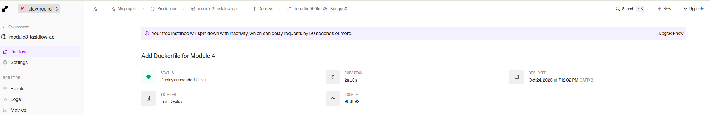
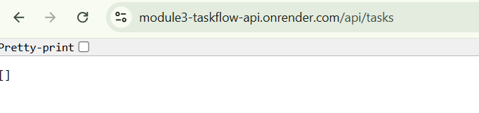
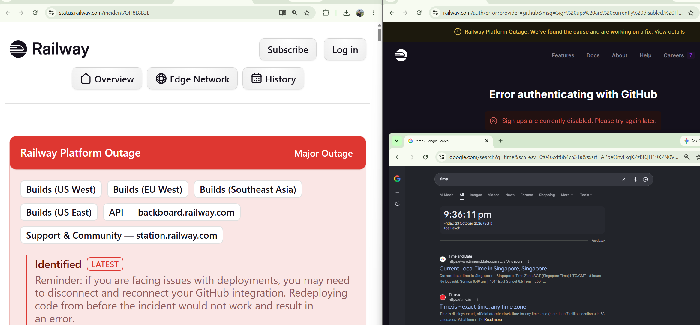

# TaskFlow API | Module 4

## Docker
Status: Completed

Successfully built and tested TaskFlow using Docker.

Image: taskflow:latest

Local API: http://localhost:8080/api/tasks

Result: []

## Cloud Deployment
Status: Completed using Render

Railway signup was unavailable due to a platform outage on 23 October 2026. Render was used as an alternative.

Live API:
https://module3-taskflow-api.onrender.com/api/tasks

## Screenshots

### Render Deployment

### Live API

### Railway Outage

## Optional 1: CI Pipeline
Status: Completed

Implemented CircleCI to automatically build, test and publish the TaskFlow Docker image to Docker Hub.

### Successful CircleCI Pipeline
[View Successful Pipeline](https://app.circleci.com/pipelines/gh/dhts1990/taskflow-api/1/details?useNewPipelines=true&workflowId=1a71533b-a3b3-4b30-9eea-b62afc66257c&job=764b1fbe-e623-4f09-bd4d-eb1a95de3f04&buildNumber=6&jobType=build)

### Docker Hub
[View Docker Image](https://hub.docker.com/r/dhts1990/taskflow-api)

Image: dhts1990/taskflow-api:latest
